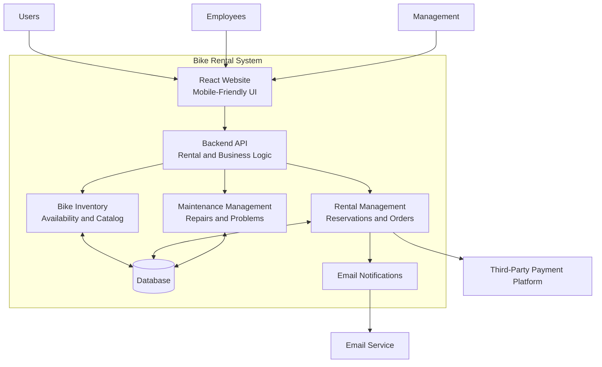

# design doc pt.1

**overview**
we are creating a system for a local bikeshop. This bike shop wants to get into rentals, our primary focus is the retal buissness. This software system allows users to update and maintain a catologue of bikes and availibility. It allows employees to schedule maintance and report problems for repair.

**actors**

    * users
    * employees
    * managment
    * 3rd party payment platform

**goals/nogoals**

    Goals
    * rent a bike 
    * pay for the rental
    * check availability of bikes
    * investigate different bike options
    * manage bike inventory
    * schedule repairs
    * update orders
    * email confirm

    Nongoals
    * delivery
    * selling bikes
    * guided bike trips
    *  other equiptment rentals

**constraints**
    * The website must use react
    * the applicaiton must work on mobile
    * we have 10000 budget
    * we must finish by the end of the term
    * we must use a 3rd party payment platform 

**assumptions**

    * the server must support multiple users
    * the user can navigate a normal site
    * apis are maintained
    * no private data is stored
    * users have internet 

**non-functional requirements**

    * The system must have > 90% uptime
    * the server can have at least 100 concurrent users
    * the average time to checkout is less than 5 mins
    * creating an account takes 2 mins or less
    * reservations must be able to be made 1 yr in advance

| Component Name | Description |
|---|---|
| React Website | Provides a mobile-friendly interface for users, employees, and management to interact with the system. |
| Backend API | Processes requests from the website and handles the system's business logic. |
| Bike Inventory | Maintains the bike catalog and tracks bike availability. |
| Rental Management | Handles reservations, rental checkout, payments, and order updates. |
| Maintenance Management | Allows employees to report bike problems and schedule repairs. |
| Database | Stores bike inventory, reservations, orders, and maintenance records. |
| Email Notifications | Generates email notifications, such as rental confirmations. |
| Third-Party Payment Platform | Processes payments for bike rentals securely through an external provider. |
| Email Service | Sends emails generated by the system to customers. |