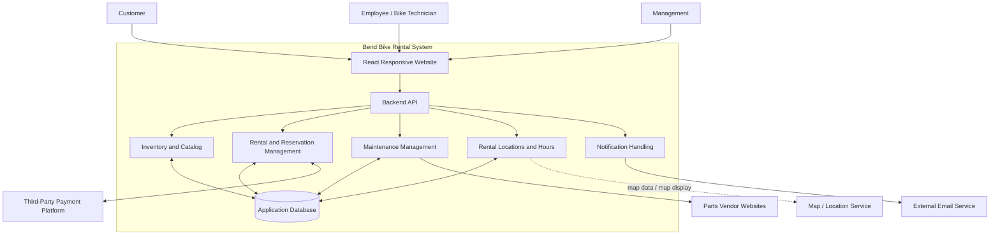

# Bend Bike Rental System — Design Document

## 1. Overview

Bend Bike wants to introduce a bike-rental service supported by a website. The system will let customers browse bike models, check availability and prices, make reservations, view reservation details, and cancel bookings. Employees will use the system to manage bike inventory and availability, track repair work, maintain bike health, and return repaired bikes to rental availability.

The website is intended to support a quicker rental process and help customers choose a suitable bike. The design below is a high-level proposal for the current partial design document. Items not established by the supplied functional specification are labeled as **proposed**, **assumptions**, or **open questions** rather than treated as confirmed requirements.

## 2. Goals

- Let customers browse available bike models and compare rental prices.
- Let customers check availability for selected dates and view hourly, daily, and weekly pricing.
- Let customers make reservations, view their reservation details, and cancel reservations.
- Let customers find rental locations on a map and view their operating hours, including information useful when returning a bike to a different location.
- Let employees manage the bike catalog and inventory.
- Let bike technicians view the repair backlog, find bike-specific parts and vendor links, report problems, and schedule or track repairs.
- Let employees return a repaired bike to rental availability.
- Support a more efficient rental process for customers and employees.

## 3. Non-goals

The system is not intended to support:

- Selling used bikes.
- Picking up or delivering bikes to customers.
- Bike tours or guided packages.
- Rentals of equipment other than bikes, unless the scope is explicitly expanded later.

## 4. Actors and external systems

| Actor or external system | Responsibilities / interaction |
|---|---|
| Customer | Browses bike models, filters by price and dates, checks availability, makes reservations, views reservation details, cancels bookings, and checks rental locations and hours. |
| Employee | Uses staff-facing features to manage inventory and reservations and support the rental process. Exact permissions remain to be defined. |
| Bike technician | Views repair work, reports bike problems, reviews parts and vendor information, updates repair status, and marks repaired bikes ready for rental. This may be an employee role. |
| Management | Oversees inventory and rental operations. Specific reporting and administrative permissions are not defined yet. |
| Third-party payment platform | Processes rental payments. The project requires use of a third-party payment platform. The provider and payment workflow have not been selected in the supplied material. |
| Email service | Proposed external dependency for sending reservation confirmations and other transactional emails. The service and failure behavior remain to be selected. |
| Map/location service | Proposed external dependency if an embedded map or geocoding service is needed. The service and source of location/hour data remain to be selected. |
| Parts vendors | External websites linked from bike repair records so technicians can find relevant parts. No ordering integration is currently specified. |

## 5. Constraints

- The website must use React.
- The application must work on mobile devices. The current interpretation is a responsive website, not a separate native mobile app; confirm this with the project stakeholders.
- The project budget is $10,000. The currency and what costs are included should be confirmed.
- The project must be completed by the end of the academic term. The exact deadline should be recorded in the project plan.
- A third-party payment platform must be used.
- The system is intended for a local bike shop and is focused on bike rentals.

## 6. Assumptions

These are working assumptions, not guaranteed facts. They should be validated as the design becomes more detailed.

- Customers and employees will access the online system using an internet connection.
- Customers have basic familiarity with using a website.
- The server must support multiple users. This is also a system requirement and should be verified through load testing.
- External APIs and services will be maintained by their providers, but outages and API changes are still possible.
- The system will avoid storing raw payment-card details; payment processing should be delegated to the selected payment provider.
- The system may need to store some customer information to manage accounts and reservations. Therefore, the original assumption that “no private data is stored” must be clarified before implementation.
- Bike inventory, rental availability, repair status, prices, rental locations, and opening hours will be maintained with sufficiently accurate information by authorized staff or a trusted data source.

## 7. Non-functional requirements

The following targets come from the initial design notes unless marked as a recommendation or clarification.

| Requirement | Current target | Notes / clarification needed |
|---|---|---|
| Availability | More than 90% uptime | This target is unusually low for a customer-facing service. Confirm whether it is intentional and define the measurement period and maintenance exclusions. |
| Concurrent users | At least 100 concurrent users | Define the workload and acceptable response times during the test. |
| Checkout usability | Average checkout time under 5 minutes | Define the start/end points and how the average will be measured. |
| Account creation usability | Account creation takes 2 minutes or less | Define the test conditions and whether this applies to first-time users. |
| Booking horizon | Reservations can be made up to 1 year in advance | This is primarily a functional/business rule, even though it appeared in the original non-functional list. |
| Mobile support | Website works on mobile devices | Confirm supported browsers and device sizes; test responsive layouts. |
| Performance | No numeric target specified yet | Consider setting response-time targets for catalog search, availability checks, and checkout. |
| Security and privacy | No detailed target specified yet | Define authentication, staff permissions, data retention, and secure handling of payment-provider responses. |
| Accessibility | No target specified yet | Consider an accessibility target and test keyboard navigation, contrast, and form labels. |
| Recovery and backups | No target specified yet | Decide whether backups and a recovery-time target are required for the project. |

## 8. Proposed high-level architecture

The design separates the customer/staff website from the backend and the major business responsibilities. The backend is the trusted entry point for application operations. The browser should not connect directly to the database.



### Architecture notes

- **React Responsive Website** provides the customer-facing pages and staff-facing screens.
- **Backend API** validates requests, applies business rules, and coordinates the business components.
- **Inventory and Catalog** manages bike descriptions, categories, prices or pricing references, and availability status.
- **Rental and Reservation Management** handles reservation creation, reservation details, cancellation, and coordination with payment processing.
- **Maintenance Management** tracks reported problems and repair work and prevents bikes that are not ready from being offered as available.
- **Rental Locations and Hours** provides location information and operating hours. The source and maintenance process for this information still need to be chosen.
- **Notification Handling** prepares and triggers reservation-confirmation emails. An external email provider sends them.
- **Application Database** persists the system's operational records.
- **Third-party services** are outside the system boundary. The system should handle provider errors and should not assume every external service is always available.

This is a high-level flowchart used as a component-style diagram. If the course specifically requires UML component notation, the diagram may need to be converted to the required notation.

## 9. Component descriptions

| Component name | Description |
|---|---|
| React Responsive Website | Customer and staff interface for browsing bikes, managing reservations, and performing staff tasks on desktop and mobile browsers. |
| Backend API | Receives website requests, validates input and permissions, and coordinates application operations. |
| Inventory and Catalog | Stores and exposes bike information, categories, prices or pricing references, and rental availability. |
| Rental and Reservation Management | Creates reservations, returns reservation details, handles cancellations, and coordinates payment status. |
| Maintenance Management | Records bike problems and repair work, provides a repair backlog, and tracks when a bike can return to rental service. |
| Rental Locations and Hours | Provides rental/return location details and operating hours for display to customers. |
| Notification Handling | Creates and triggers transactional notifications such as reservation confirmations. |
| Application Database | Stores bike, reservation, maintenance, location, and other required application records. |
| Third-Party Payment Platform | External provider used to process payments; provider selection and exact integration are undecided. |
| External Email Service | Sends notification emails; provider selection and delivery-failure handling are undecided. |
| Map / Location Service | Optional external service for displaying rental locations on a map; exact service is undecided. |
| Parts Vendor Websites | External vendor pages linked from repair information; the current scope specifies links, not automated purchasing. |

## 10. Main workflows

These workflows summarize the supplied scenarios and identify important system interactions. Detailed rules remain to be specified.

### 10.1 Browse and reserve a bike

1. A customer opens the website.
2. The customer browses bike models and filters by relevant options, price range, and rental dates.
3. The system shows applicable hourly, daily, and weekly prices and availability.
4. The customer selects a bike and submits a reservation request.
5. The backend checks availability for the requested rental period before creating the reservation.
6. The system coordinates payment with the third-party payment platform, according to the payment timing chosen by the business.
7. The reservation is recorded and a confirmation email is requested.

**Open decision:** Whether payment is required at booking, at pickup, or at another point is not specified yet. The reservation should not be shown as paid unless the payment provider confirms success.

### 10.2 View or cancel a reservation

1. A customer opens their reservation details.
2. The system verifies that the customer is authorized to view that reservation.
3. If cancellation is allowed, the customer requests cancellation.
4. The system updates the reservation and releases the bike for the affected period, if appropriate.
5. Any refund or payment reversal is handled according to a cancellation policy that still needs to be defined.

**Open decision:** Define cancellation deadlines, refund rules, and whether customers must have an account to view or cancel a reservation.

### 10.3 Report a bike problem and complete a repair

1. An employee or technician records a bike problem.
2. The bike is marked unavailable for rental when its condition requires repair.
3. The technician views the repair backlog and the relevant bike details.
4. The technician can view related parts information and vendor links.
5. The technician records the repair outcome.
6. An authorized employee marks the bike ready for rental when it is safe and available.

**Design rule to confirm:** A bike under repair or otherwise unavailable must not be offered for an overlapping rental period.

### 10.4 Find a rental or return location

1. A customer opens the rental-location view.
2. The system displays known rental locations on a map and provides operating hours.
3. The customer uses this information to identify a convenient return location.

**Open decision:** The functional specification describes finding another return location, but it does not establish whether a rental may be returned to any location or whether a return-location change requires staff approval.

## 11. Data and business rules to consider

The following are proposed data concepts inferred from the workflows. They are not a finalized database schema.

| Data concept | Likely information | Notes |
|---|---|---|
| Bike | Bike identifier, model, category, description, condition, rental status | Exact categories and fields need to be defined. |
| Pricing | Rental duration type and price | Must support hourly, daily, and weekly pricing as described in the functional specification. |
| Reservation | Reservation identifier, customer reference, bike or bike category, start/end time, status, payment status | Confirm whether a reservation holds a specific bike or a model/category until fulfillment. |
| Customer | Account identifier and necessary contact information | Collect only the information needed for the agreed workflow. |
| Maintenance record | Bike reference, reported problem, status, timestamps, repair notes | Parts and vendor links may be associated with a maintenance record. |
| Rental location | Location identifier, address or map coordinates, opening hours | Confirm whether there are multiple shop/return locations and who maintains this data. |
| Payment reference | Provider transaction identifier and payment status | Prefer provider-hosted/tokenized payment handling; do not store raw card details. |
| Notification record | Reservation reference, notification type, delivery status if available | Useful for investigating failed confirmation emails; exact logging policy is undecided. |

### Availability rules

- Availability must account for the requested rental dates and duration.
- The system should avoid allowing two confirmed reservations for the same physical bike during overlapping periods.
- A bike that is under repair or otherwise unavailable should not be offered for rental.
- The business must define how cleaning, preparation, late returns, and turnaround time affect availability. These rules are not specified in the current materials.
- Reservations may be made up to one year in advance, based on the current stated target.

## 12. Security, privacy, and error handling

These are design considerations to resolve, not fully specified requirements yet.

- Use authentication for account-based reservation access and staff-only features if those features require login.
- Apply role-based authorization so customers cannot change inventory or repair records, and staff access matches their responsibilities.
- Validate requests on the backend rather than relying only on browser-side checks.
- Use the payment provider for sensitive payment entry and processing; store only the minimum payment reference and status needed by the application.
- Decide what customer information is necessary, how long it is retained, and who can access it.
- Handle payment-provider failures without incorrectly marking an unpaid reservation as paid.
- Handle email delivery failures without losing the reservation record; decide whether the system retries or alerts staff.
- Handle map or external API outages gracefully and show useful information when the service is unavailable.

## 13. Risks and unresolved questions

1. **Payment workflow:** When is payment collected, and what happens if payment fails?
2. **Cancellation policy:** What deadlines, fees, and refunds apply?
3. **Return locations:** Can customers return bikes to a different location, and how is that recorded?
4. **Customer accounts:** Is an account mandatory to reserve, view, or cancel a booking?
5. **Inventory model:** Is each reservation for a specific physical bike or for a model/category fulfilled later by staff?
6. **Bike categories and filters:** Which categories and attributes must customers be able to filter by? The functional scenario mentions skill level, kids' bikes, gender-oriented categories, price, and dates; the final catalog vocabulary should be agreed with the shop.
7. **Maintenance rules:** Who can mark a bike ready, and what checks are required before it becomes rentable?
8. **External providers:** Which payment, email, and map services will be used?
9. **Private data:** The initial assumption says no private data is stored, but accounts and reservations may require customer contact information. Define the actual data requirements.
10. **Uptime:** Is greater than 90% uptime the intended target? Define measurement and maintenance exclusions.
11. **Load and performance:** Define the workload used to verify support for 100 concurrent users and set response-time targets.
12. **Scope and budget:** Confirm the exact deadline, budget currency, and whether provider fees/hosting are included.

## 14. Suggested next steps

1. Confirm the payment, cancellation, and return-location rules with the bike shop.
2. Clarify customer account and data-storage requirements.
3. Define the bike availability model, including maintenance and overlapping reservations.
4. Select external providers only after checking cost, project time, and integration complexity.
5. Convert the non-functional targets into measurable acceptance tests.
6. Review the use-case diagram in the repository and make sure it matches the actors and workflows described here.
7. Add detailed API contracts, database design, and error flows in later design-document sections as the project requires.

---

## Appendix A — Functional specification (original, unchanged)

The following is included verbatim from `funcSpec1.md`; wording and content have not been edited.

````markdown
# Funcional spec 1

**1: Description**

The software system we are designing for bend bike is a rental system where employees and customers can inspect inventory and rent out a list of available bikes. This software is enables our customers to make reservations, view available models, compare prices. This software helps our employees manage inventory, maintain bike health and expodite the rental process(time per customer)

**2: User scenarios**

    1: Bob and his familly are visiting bend and want to bike around the old mill. He wants to rent bikes from us but he knows very little. Bob logs onto our site and can easilly navigate bikes of all levels beginner to expert, kids, boys, girls, and filter for price range. Bob also has the ability to filter availability by the days hes in town as well as see pricing for dialy weekly and hourly rentals for each model.

    2: Steven is one of our bike techs. Steven logs on to our website as an employee and can see the backlog of repairs. While working Steven can find specific parts for each bike and links to vendors so if he needs to order something its easilly available. Once he has fixed the bike he has the  ability to re activate bikes and add it back to the catologue ready for rental.

    3:As a community member who has reserved a bike, I want to view my reservation details and cancel my booking if my plans change,So that I can manage my rental without contacting the rental shop directly.

    4:John has rented a bike but cant make it back up awbrey butte to his original pickup destination,he wants to view rental locations on a map and see their hours of operation,So that I can find a convenient place to return his rental bike.

**3: Non-goals**

    * We will not be selling used bikes
    * We will not be picking up / delivering bikes to customers
    * We will not have any bike tours or guided packages available

**4: Use case diagram**

**I am unsure if this will work my diagram is in the repo as well**
````
