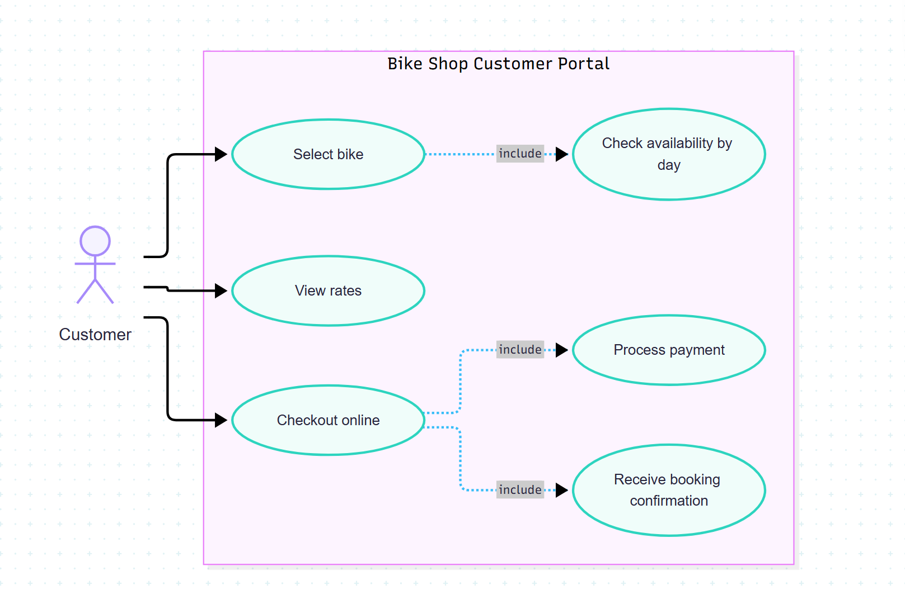

# Funcional spec 1

**1: Description**

The software system we are designing for bend bike is a rental system where employees and customers can inspect inventory and rent out a list of available bikes. This software is enables our customers to make reservations, view available models, compare prices. This software helps our employees manage inventory, maintain bike health and expodite the rental process(time per customer)

**2: User scenarios**

    1: Bob and his familly are visiting bend and want to bike around the old mill. He wants to rent bikes from us but he knows very little. Bob logs onto our site and can easilly navigate bikes of all levels beginner to expert, kids, boys, girls, and filter for price range. Bob also has the ability to filter availability by the days hes in town as well as see pricing for dialy weekly and hourly rentals for each model.

    2: Steven is one of our bike techs. Steven logs on to our website as an employee and can see the backlog of repairs. While working Steven can find specific parts for each bike and links to vendors so if he needs to order something its easilly available. Once Steven has fixed the bike he has the  ability to re activate bikes and add it back to the catologue ready for rental.

    3:As a community member who has reserved a bike, I want to view my reservation details and cancel my booking if my plans change,So that I can manage my rental without contacting the rental shop directly.

    4:John has rented a bike but cant make it back up awbrey butte to his original pickup destination,he wants to view rental locations on a map and see their hours of operation,So that I can find a convenient place to return his rental bike.

**3: Non-goals**

    * We will not be selling used bikes
    * We will not be picking up / delivering bikes to customers
    * We will not have any bike tours or guided packages available

**4: Use case diagram**

**I am unsure if this will work my diagram is in the repo as well**