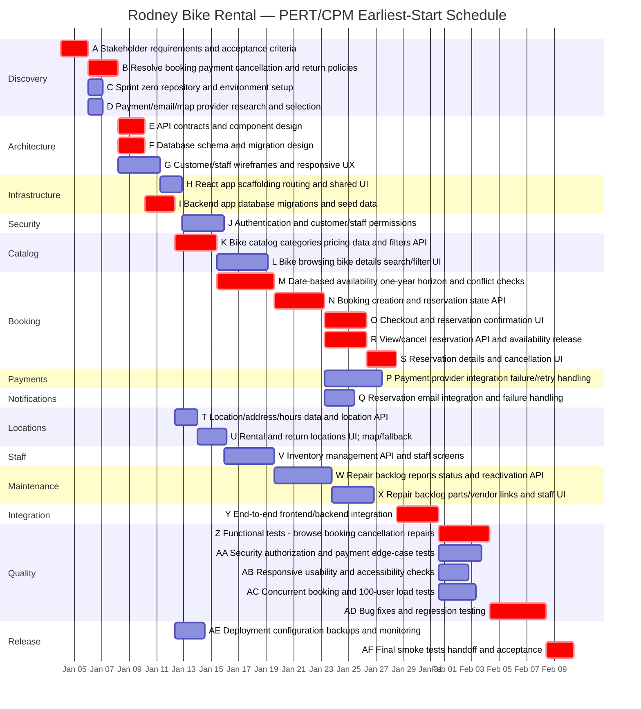

# Rodney’s Bike Rental System — Project Schedule

> **Planning baseline (revised):** Preliminary estimates for the scope described in `design_doc_ai_2 (1).md`. All durations are **working-day equivalents**; no actual start date or team capacity was supplied. Estimates and dependencies should be reviewed with the developers and product owner.

## 1. Scope and estimation assumptions

- **Basis:** The design document includes customer browsing, pricing, availability, checkout, reservations/cancellations, staff inventory and repairs, locations/hours, React mobile support, and third-party payments. The earlier schedule had only generic UI/API work and significantly underrepresented these features.
- **PERT:** `Expected duration = (optimistic + 4 × most likely + pessimistic) / 6`. Each leaf task has its own O/M/P estimate; summary phases are **not** separately estimated, avoiding double-counting.
- **CPM:** Finish-to-start dependencies; ES starts at day 0; tasks can run in parallel with adequate staffing. CPM durations are calculated at full precision and only **displayed** to 2 decimal places.
- **Calendar:** One simulated working day is a duration unit, not a fixed calendar date. The Mermaid Gantt chart uses an illustrative continuous 24-hour/day clock to preserve CPM offsets; it is **not** an actual weekday/holiday staffing calendar.
- **Scope qualifiers:** Payments and responsive React support are required. Email sending and embedded map service are **proposed** in the design; accounts/authentication requirements and business rules need confirmation. Proposed capabilities are included provisionally, not treated as finalized requirements.
- **Confidence:** These are reasoned planning estimates for a small experienced team using existing frameworks/services, **not** commitments. Staff limits, vendor approvals, new requirements, and test findings could increase the calendar schedule.

## 2. Missing work identified from the design

| Design requirement / risk | Added work |
|---|---|
| Reservation creation, details and cancellation | M, N, O, R, S |
| Hourly/daily/weekly pricing, bike categories, date filters | K, L, M |
| Safe availability checks including concurrent bookings and repair status | M, W, AC |
| Required third-party payment handling and failure paths | D, P, AA |
| Employee inventory management and repair lifecycle | J, V, W, X |
| Locations, hours, map and textual fallback | T, U |
| Proposed email confirmations and delivery failure handling | D, Q |
| Authentication, ownership checks, role permissions | J, AA |
| React responsive layouts, mobile usability and accessibility | G, H, AB |
| 100 simultaneous users and checkout usability targets | AC, AB |
| Production configuration, backups, smoke test and handoff | AE, AF |
| Policy decisions on cancellations, refunds, account access and return locations | B |

## 3. Work breakdown structure and PERT inputs

`(O, M, P)` = optimistic, most likely, and pessimistic **working days**. Task IDs link this WBS to the CPM table and Gantt chart.

### Discovery

- **A** Stakeholder requirements and acceptance criteria (1, 2, 3)
- **B** Resolve booking, payment, cancellation and return policies (1, 2, 4)
- **C** Sprint zero, repository and environment setup (0.5, 1, 2)
- **D** Payment/email/map provider research and selection (0.5, 1, 2) — *provisional*

### Architecture

- **E** API contracts and component design (1, 2, 3)
- **F** Database schema and migration design (1, 2, 3)
- **G** Customer/staff wireframes and responsive UX (1.5, 3, 5)

### Infrastructure

- **H** React app scaffolding, routing and shared UI (0.5, 1.5, 3)
- **I** Backend app, database migrations and seed data (1, 2, 4)

### Security

- **J** Authentication and customer/staff permissions (1.5, 3, 5) — *provisional*

### Catalog

- **K** Bike catalog, categories, pricing data and filters API (1.5, 3, 5)
- **L** Bike browsing, bike details, search/filter UI (2, 3.5, 6)

### Booking

- **M** Date-based availability, one-year horizon and conflict checks (2, 4, 7)
- **N** Booking creation and reservation state API (2, 3.5, 6)
- **O** Checkout and reservation confirmation UI (1.5, 3, 5)
- **R** View/cancel reservation API and availability release (1.5, 3, 5)
- **S** Reservation details and cancellation UI (1, 2, 4)

### Payments

- **P** Payment provider integration, failure/retry handling (2, 4, 7)

### Notifications

- **Q** Reservation email integration and failure handling (1, 2, 4) — *provisional*

### Locations

- **T** Location/address/hours data and location API (0.75, 1.5, 3)
- **U** Rental and return locations UI; map/fallback (1, 2, 4) — *provisional*

### Staff

- **V** Inventory management API and staff screens (2, 3.5, 6)

### Maintenance

- **W** Repair backlog, reports, status and reactivation API (2, 4, 7)
- **X** Repair backlog, parts/vendor links and staff UI (1.5, 3, 5)

### Integration

- **Y** End-to-end frontend/backend integration (1.5, 3, 5)

### Quality

- **Z** Functional tests: browse, booking, cancellation, repairs (2, 3.5, 6)
- **AA** Security, authorization and payment edge-case tests (1.5, 3, 5)
- **AB** Responsive, usability and accessibility checks (1, 2, 4)
- **AC** Concurrent booking and 100-user load tests (1, 2.5, 5)
- **AD** Bug fixes and regression testing (2, 4, 7)

### Release

- **AE** Deployment, configuration, backups and monitoring (1, 2, 4)
- **AF** Final smoke tests, handoff and acceptance (1, 2, 3)

## 4. Complete CPM table

| ID | Task | O | M | P | PERT duration | Dependencies | ES | EF | LS | LF | Slack |
|---|---|---:|---:|---:|---:|---|---:|---:|---:|---:|---:|
| A ★ | **Stakeholder requirements and acceptance criteria** | 1 | 2 | 3 | 2.00 | None | 0.00 | 2.00 | -0.00 | 2.00 | 0.00 |
| B ★ | **Resolve booking, payment, cancellation and return policies** | 1 | 2 | 4 | 2.17 | A | 2.00 | 4.17 | 2.00 | 4.17 | 0.00 |
| C | Sprint zero, repository and environment setup | 0.5 | 1 | 2 | 1.08 | A | 2.00 | 3.08 | 3.08 | 4.17 | 1.08 |
| D | Payment/email/map provider research and selection | 0.5 | 1 | 2 | 1.08 | A | 2.00 | 3.08 | 19.25 | 20.33 | 17.25 |
| E ★ | **API contracts and component design** | 1 | 2 | 3 | 2.00 | B, C | 4.17 | 6.17 | 4.17 | 6.17 | 0.00 |
| F ★ | **Database schema and migration design** | 1 | 2 | 3 | 2.00 | B, C | 4.17 | 6.17 | 4.17 | 6.17 | 0.00 |
| G | Customer/staff wireframes and responsive UX | 1.5 | 3 | 5 | 3.08 | B | 4.17 | 7.25 | 5.83 | 8.92 | 1.67 |
| H | React app scaffolding, routing and shared UI | 0.5 | 1.5 | 3 | 1.58 | C, G | 7.25 | 8.83 | 8.92 | 10.50 | 1.67 |
| I ★ | **Backend app, database migrations and seed data** | 1 | 2 | 4 | 2.17 | E, F | 6.17 | 8.33 | 6.17 | 8.33 | 0.00 |
| J | Authentication and customer/staff permissions | 1.5 | 3 | 5 | 3.08 | H, I | 8.83 | 11.92 | 10.50 | 13.58 | 1.67 |
| K ★ | **Bike catalog, categories, pricing data and filters API** | 1.5 | 3 | 5 | 3.08 | I | 8.33 | 11.42 | 8.33 | 11.42 | 0.00 |
| T | Location/address/hours data and location API | 0.75 | 1.5 | 3 | 1.62 | I, B | 8.33 | 9.96 | 20.71 | 22.33 | 12.37 |
| AE | Deployment, configuration, backups and monitoring | 1 | 2 | 4 | 2.17 | I, D | 8.33 | 10.50 | 33.25 | 35.42 | 24.92 |
| L | Bike browsing, bike details, search/filter UI | 2 | 3.5 | 6 | 3.67 | H, K | 11.42 | 15.08 | 15.58 | 19.25 | 4.17 |
| M ★ | **Date-based availability, one-year horizon and conflict checks** | 2 | 4 | 7 | 4.17 | I, K | 11.42 | 15.58 | 11.42 | 15.58 | 0.00 |
| U | Rental and return locations UI; map/fallback | 1 | 2 | 4 | 2.17 | H, T, D | 9.96 | 12.12 | 22.33 | 24.50 | 12.37 |
| V | Inventory management API and staff screens | 2 | 3.5 | 6 | 3.67 | J, K, H | 11.92 | 15.58 | 13.58 | 17.25 | 1.67 |
| N ★ | **Booking creation and reservation state API** | 2 | 3.5 | 6 | 3.67 | M, J | 15.58 | 19.25 | 15.58 | 19.25 | 0.00 |
| W | Repair backlog, reports, status and reactivation API | 2 | 4 | 7 | 4.17 | I, J, V | 15.58 | 19.75 | 17.25 | 21.42 | 1.67 |
| O ★ | **Checkout and reservation confirmation UI** | 1.5 | 3 | 5 | 3.08 | L, N | 19.25 | 22.33 | 19.25 | 22.33 | 0.00 |
| P | Payment provider integration, failure/retry handling | 2 | 4 | 7 | 4.17 | D, N | 19.25 | 23.42 | 20.33 | 24.50 | 1.08 |
| Q | Reservation email integration and failure handling | 1 | 2 | 4 | 2.17 | D, N | 19.25 | 21.42 | 22.33 | 24.50 | 3.08 |
| R ★ | **View/cancel reservation API and availability release** | 1.5 | 3 | 5 | 3.08 | N, B | 19.25 | 22.33 | 19.25 | 22.33 | 0.00 |
| X | Repair backlog, parts/vendor links and staff UI | 1.5 | 3 | 5 | 3.08 | W, H | 19.75 | 22.83 | 21.42 | 24.50 | 1.67 |
| S ★ | **Reservation details and cancellation UI** | 1 | 2 | 4 | 2.17 | O, R | 22.33 | 24.50 | 22.33 | 24.50 | 0.00 |
| Y ★ | **End-to-end frontend/backend integration** | 1.5 | 3 | 5 | 3.08 | O, P, Q, S, U, V, X | 24.50 | 27.58 | 24.50 | 27.58 | 0.00 |
| Z ★ | **Functional tests: browse, booking, cancellation, repairs** | 2 | 3.5 | 6 | 3.67 | Y | 27.58 | 31.25 | 27.58 | 31.25 | 0.00 |
| AA | Security, authorization and payment edge-case tests | 1.5 | 3 | 5 | 3.08 | Y | 27.58 | 30.67 | 28.17 | 31.25 | 0.58 |
| AB | Responsive, usability and accessibility checks | 1 | 2 | 4 | 2.17 | Y | 27.58 | 29.75 | 29.08 | 31.25 | 1.50 |
| AC | Concurrent booking and 100-user load tests | 1 | 2.5 | 5 | 2.67 | Y | 27.58 | 30.25 | 28.58 | 31.25 | 1.00 |
| AD ★ | **Bug fixes and regression testing** | 2 | 4 | 7 | 4.17 | Z, AA, AB, AC | 31.25 | 35.42 | 31.25 | 35.42 | 0.00 |
| AF ★ | **Final smoke tests, handoff and acceptance** | 1 | 2 | 3 | 2.00 | AD, AE | 35.42 | 37.42 | 35.42 | 37.42 | 0.00 |

`★` = zero-slack critical task. Rounding can cause ±0.01 differences if displayed table cells are recalculated by hand.

## 5. Schedule results

- **PERT/CPM expected project duration:** **37.42 working days** (unconstrained staffing, parallel execution).
- **Total estimated effort if one person performs every task:** **87.21 person-days** (not the calendar project duration).
- **Critical tasks (zero slack):** A, B, E, F, I, K, M, N, O, R, S, Y, Z, AD, AF.
- **Critical path:** A → B → E → I → K → M → N → O → S → Y → Z → AD → AF.
- **Critical path:** A → B → F → I → K → M → N → O → S → Y → Z → AD → AF.
- **Critical path:** A → B → E → I → K → M → N → R → S → Y → Z → AD → AF.
- **Critical path:** A → B → F → I → K → M → N → R → S → Y → Z → AD → AF.

### Monte Carlo schedule risk (revised network)

A **150,000-iteration** independent beta-PERT simulation was run on these individual task estimates and the exact CPM dependency network. These are simulated duration percentiles, **not guarantees**:

| Percentile | Completion time (working days) |
|---|---:|
| P50 | 38.54 |
| P80 | 40.36 |
| P90 | 41.32 |
| P95 | 42.14 |

**Planning suggestion:** Allow approximately **42 working days** at this model’s P90, subject to team availability and unresolved product decisions. The old **14.04-day P90** and **17.67-day phase sum** used a different, incomplete scope; they are **superseded**, not directly comparable.

## 6. Mermaid Gantt chart

This chart reproduces **ES** from the CPM network with explicit illustrative timestamps rather than unreliable cross-section `after` references. **One duration day is visualized as 24 consecutive hours**; for actual dates, apply a work calendar and realistic team capacity. `crit` indicates CPM zero slack.

## 7. Estimate sanity check and outstanding decisions

- **Original estimate too small for described scope:** A ~10.5-day CPM/17.67-day phase estimate did not explicitly include bookings, payment processing, a staff portal, maintenance, or load/security tests. The revised plan assigns them their own effort and dependencies.
- **Potentially optimistic work:** Concurrent-safe availability, payment/retry handling, auth/role boundaries, and end-to-end tests may take longer than modeled if the team is unfamiliar with the technologies. These tasks have deliberately wider PERT ranges.
- **Avoid ambiguous labels:** “Connect API,” “Connect database,” “quality assurance (1 day),” and “implement external dependencies” are replaced with bounded feature, integration, and verification deliverables.
- **Acceptance criteria to confirm:** Booking/payment timing, refund policy, account necessity, return-location rules, physical-bike vs category reservations, technician permissions, and turnaround time. These may materially change the estimates and dependencies.
- **Validate budget/deadline:** Design notes describe a $10,000 budget and academic-term deadline, but there is no team size, hourly rate, exact due date, or host/provider fee estimate; this schedule cannot establish feasibility against those constraints.
- **Dependency caveat:** A fully integrated end-to-end verification gate is assumed before final testing. An iterative team could test features sooner and shorten the critical path, but this would require reworking the dependency network.
- **Schedule vs effort:** CPM assumes enough people to execute all eligible parallel tasks. A single developer would need approximately the total effort plus coordination/waiting, not the CPM duration.

